<p align="right"><a href="./README.md"></a><a href="./README.fr.md"></a></p>

<div align="center">



<a href="#boot"></a>
<a href="#projet-phare"></a>
<a href="#mes-outils"></a>
<a href="#git-log"></a>
<a href="#certifications"></a>
<a href="#mon-cv"></a>
<a href="#contact"></a>

<br><br>

**Je transforme des idées en applications complètes : de la base de données à l'interface, avec une touche d'intelligence artificielle.**


<br><br>

<a href="https://github.com/Chaymae-El-Bahloul/Chaymae-El-Bahloul/releases/download/cv-v1.0/CV_Chaymae_EL_BAHLOUL_FR.pdf"></a>

</div>

<p align="center"></p>

## Boot

```text
$ ./chaymae --boot

[  OK  ] Profil chargé .............. Chaymae El Bahloul
[  OK  ] Formation .................. Bachelor en Data Science (en cours)
[  OK  ] Base solide ................ DUT en Ingénierie des Données
[  OK  ] Stack ...................... Python · SQL · Flask · Streamlit · C
[  OK  ] Projets compilés ........... 7
[  OK  ] Stages réalisés ............ 2
[  OK  ] Certifications ............. 3
[  OK  ] Langues .................... Arabe · Français · Anglais
[ INFO ] Recherche .................. Stage de fin d'études (PFE) 2027
[ INFO ] Curiosité .................. illimitée
[ WAIT ] En attente de votre message  c.elbahloul2898@uca.ac.ma
```

<p align="center"></p>

## Choisissez votre mission

<table>
<tr>
<td width="33%" valign="top">

**Mission : recruter**

Mon projet phare, mon parcours et mes deux stages.

[Voir le projet phare](#projet-phare)<br>
[Voir mon git log](#git-log)<br>
[Voir mes certifications](#certifications)<br>
[Télécharger mon CV](#mon-cv)

</td>
<td width="33%" valign="top">

**Mission : lire le code**

Mes projets, mes technologies, mes dépôts.

[Voir les projets](#tous-mes-projets)<br>
[Voir mes outils](#mes-outils)

</td>
<td width="33%" valign="top">

**Mission : explorer**

Interrogez mon terminal, ou essayez mon portfolio interactif.

[Ouvrir le terminal](#terminal-interactif)<br>
[Voir le pipeline en direct](#pipeline-en-direct)<br>
[Aller au portfolio](https://chaymae-el-bahloul.github.io)

</td>
</tr>
</table>

<p align="center"></p>

## Mon CV

<div align="center">

**Je recherche un stage de fin d'études (PFE) en 2027** : Data Engineering, IA et développement logiciel.

<a href="https://github.com/Chaymae-El-Bahloul/Chaymae-El-Bahloul/releases/download/cv-v1.0/CV_Chaymae_EL_BAHLOUL_FR.pdf"></a>

<sub>PDF, 1 page. La version anglaise est dans le README anglais : utilisez le bouton de langue en haut.</sub>

</div>

<p align="center"></p>

## Ce que je sais faire

| Je sais... | La preuve |
| --- | --- |
| **Concevoir** une base de données et une logique métier solides | RC Gestion, Gestion des congés, stadium_db |
| **Construire** une application complète, de l'interface au déploiement | RC Gestion, GraphGen (tests, CI, Docker) |
| **Analyser et visualiser** des données pour aider à décider | Supermarket Dashboard, GraphGen |
| **Ajouter de l'IA** là où elle apporte une vraie valeur | RC Gestion (3 modèles de ML), AI ChatBot |

<p align="center"></p>

<p align="center"></p>

## Projet phare

> ### RC Gestion
> **Et si l'application pouvait prévenir les retards fiscaux au lieu de simplement les enregistrer ?**
> Une application web qui digitalise la gestion d'un cabinet comptable : dossiers clients (particuliers et entreprises), déclarations fiscales, comptabilité simplifiée, paie et suivi de création d'entreprises.
> Elle génère automatiquement les bulletins de paie, les fiches clients et les rapports PDF, envoie des alertes et intègre un module d'IA. Trois rôles : **Administrateur**, **Comptable**, **Client**.
>
>     
>
> **[Voir le code](https://github.com/Chaymae-El-Bahloul/RC-GESTION)**

<details>
<summary><b>Sous le capot de RC Gestion</b></summary>
<br>

```text
RC_Gestion_/
├── app.py            interface et navigation
├── db.py             logique métier et données
├── pdf_reports.py    bulletins de paie et rapports
└── ai.py             modèles d'IA
```

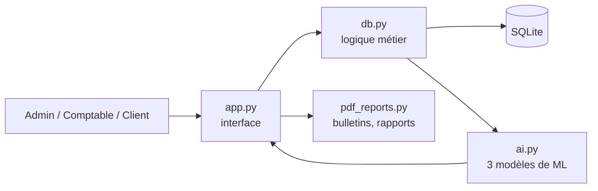

| Modèle | Mission |
| --- | --- |
| Random Forest | Prédire le risque de retard fiscal d'un client |
| Régression linéaire | Prévoir le chiffre d'affaires du mois suivant |
| Isolation Forest | Détecter les montants déclarés suspects |

</details>

## Tous mes projets

<table>
<tr>
<td width="33%" valign="top">

**GraphGen** *(projet en binôme)*

Importez un fichier CSV ou Excel et obtenez une analyse exploratoire et des graphiques interactifs, sans écrire une seule ligne de code. 12 tests, CI GitHub Actions, Docker.

`Flask` `pandas` `Plotly` `Docker`

[Voir le code](https://github.com/Chaymae-El-Bahloul/GraphGen)

</td>
<td width="33%" valign="top">

**Smart Data Pipeline** *(équipe de trois)*

Pipeline de données auto-adaptatif, réalisé pour le projet de fin d'études du DUT.

`Python` `Data pipeline`

[Voir le code](https://github.com/Samah-boudallaa/smart-data-pipeline)

</td>
<td width="33%" valign="top">

**Supermarket Dashboard**

Tableau de bord interactif : 6 filtres, 4 indicateurs clés et 9 types de visualisations (boxplot, heatmap, sunburst, gauge...), mis à jour en temps réel.

`Streamlit` `Plotly` `Pandas`

[Voir le code](https://github.com/Chaymae-El-Bahloul/dashboard-supermarche)

</td>
</tr>
<tr>
<td width="33%" valign="top">

**Gestion des congés** *(stage 2025)*

Suivi des employés, demandes et validation hiérarchique pour la Commune d'El Kelâa des Sraghna. Interface bilingue français / arabe.

`Flask` `SQLAlchemy` `SQLite`

[Voir le code](https://github.com/Chaymae-El-Bahloul/Gestion-Conges)

</td>
<td width="33%" valign="top">

**AI ChatBot**

Chatbot multilingue basé sur l'API Gemini, avec gestion des requêtes utilisateur.

`Python` `API Gemini`

[Voir le code](https://github.com/Chaymae-El-Bahloul/AI-chatbot)

</td>
<td width="33%" valign="top">

**stadium_db** *(équipe de 5)*

Application de bureau pour la gestion des étudiants (ajout, modification, suppression, recherche, affichage).

`C` `GTK+ 3` `MySQL`

[Voir le code](https://github.com/Chaymae-El-Bahloul/stadium_db)

</td>
</tr>
</table>

<p align="center"><a href="https://github.com/Chaymae-El-Bahloul?tab=repositories">Voir tous mes dépôts</a></p>

<p align="center"></p>

## Mes outils

<p align="center"></p>

<p align="center"></p>

*Ouvrez un domaine pour voir tout l'arsenal.*

<details><summary><b>Langages</b></summary>

Python, R, SQL, JavaScript, PHP, C

</details>

<details><summary><b>Web et applications</b></summary>

Flask, Streamlit, SQLAlchemy, HTML / CSS

</details>

<details><summary><b>Bases de données</b></summary>

MySQL, Oracle SQL Developer, SQLite, Data Warehouse

</details>

<details><summary><b>Big Data et analyse</b></summary>

Hadoop, Kafka, Apache Spark, Power BI, Data Mining, machine learning

</details>

<details><summary><b>Intelligence artificielle</b></summary>

IA générative, API Gemini, Microsoft 365 Copilot, scikit-learn

</details>

<details><summary><b>Outils de travail</b></summary>

Git / GitHub, Docker, Ubuntu, WSL, VirtualBox, VS Code

</details>

<p align="center"></p>

## En chiffres

<table>
<tr>
<td width="50%" align="center"></td>
<td width="50%" align="center"></td>
</tr>
</table>

<p align="center"></p>

## Pipeline en direct

<p align="center"></p>

<details>
<summary><b>Afficher le journal de la dernière exécution</b></summary>

<!--PIPELINE:START-->
```text
$ ./pipeline --status

[  OK  ] extraction ............ 7 dépôts, 15 appels API
[  OK  ] transformation ........ 6 langages, 24 commits sur 30 jours
[  OK  ] chargement ............ assets/pipeline-fr.svg, data/history.csv
[ INFO ] dernière exécution .... 2026-11-27 06:37 UTC (run #7)
```
<!--PIPELINE:END-->

</details>

<p align="center"></p>

## Terminal interactif

*Cliquez sur une commande pour voir la réponse.*

<details>
<summary><code>$ about</code></summary>

```text
Chaymae El Bahloul, étudiante en Bachelor Data Science (EST Kelâa des Sraghna)
après un DUT en Ingénierie des Données. Je transforme des idées en applications
complètes : base de données, interface et IA.
```

</details>

<details>
<summary><code>$ ls projects/</code></summary>

```text
RC_Gestion/    GraphGen/    smart-data-pipeline/    dashboard-supermarche/
gestion-conges/    ai-chatbot/    stadium_db/
```

</details>

<details>
<summary><code>$ languages</code></summary>

```text
Arabe (langue maternelle) · Français (professionnel) · Anglais (professionnel)
```

</details>

<details>
<summary><code>$ fortune</code></summary>

```text
Un bug n'est qu'une fonctionnalité
qui n'a pas encore trouvé son utilisateur.
```

</details>

<details>
<summary><code>$ sudo hire chaymae</code></summary>

```text
[sudo] mot de passe : ********
Permission accordée.
Prochaine étape : écrire à c.elbahloul2898@uca.ac.ma
```

</details>

<p align="center"></p>

## Qui suis-je ?

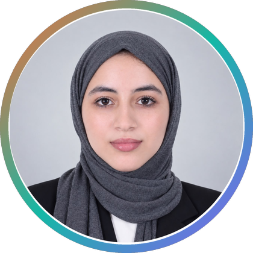

J'aime construire des applications complètes autour de la donnée : interface, logique métier, base de données et intelligence artificielle. Chaque projet est l'occasion d'apprendre une nouvelle brique, de la paie aux chatbots en passant par la visualisation.

```python
chaymae = {
    "formation":    "Bachelor en Data Science (EST Kelâa des Sraghna)",
    "base":         "DUT en Ingénierie des Données, Université Cadi Ayyad",
    "stack":        ["Python", "SQL", "Flask", "Streamlit"],
    "passion":      "IA & Data",
    "recherche":    "Stage de fin d'études (PFE) 2027",
    "localisation": "El Kelâa des Sraghna, Maroc",
    "langues":      ["Arabe", "Français", "Anglais"],
}
```

<br clear="all">

<p align="center"></p>

## Git log

<p align="center"></p>

*Mon parcours, raconté comme un historique de commits.*

```text
$ git log --oneline

a7f3c21 (HEAD -> main) 2026-2027       Bachelor en Data Science, EST Kelâa des Sraghna (en cours)
5be90d4                Avr-Juin 2026   Stage : RC Gestion (architecture en couches, paie, bulletins, rôles)
3c1d8e7                Juin-Juil 2025  Stage : gestion des congés, Commune d'El Kelâa des Sraghna
9a02f6b                2024-2026       DUT en Ingénierie des Données, EST Kelâa des Sraghna, UCA
1e4d7a0                2023-2024       Baccalauréat Sciences Physiques, Lycée Al Maghrib Al Arabi
0000000 (initial)      depuis toujours curiosité
```

<details>
<summary><b>Langues</b></summary>
<br>

Arabe (langue maternelle) · Français (professionnel) · Anglais (professionnel)

</details>

<p align="center"></p>

## Certifications

<table>
<tr>
<td width="33%" valign="top">

**Career Essentials in Generative AI**

Microsoft et LinkedIn Learning

Fondamentaux de l'IA générative, rédaction de prompts efficaces et usage responsable des outils d'IA au travail.

`IA générative` `Prompting` `IA responsable`

</td>
<td width="33%" valign="top">

**Learning Microsoft 365 Copilot**

LinkedIn Learning

Utiliser Copilot dans Word, Excel, PowerPoint, Outlook et Teams pour rédiger, analyser et synthétiser plus vite.

`Microsoft 365` `Copilot` `Productivité`

</td>
<td width="33%" valign="top">

**Master Series 4.0: Smart Factories, Hypermanufacturing & Beyond**

ONUDI et Agence de Développement du Digital (ADD), Maroc

Attestation de participation à la série de webinaires « Industrie 4.0 et transformation digitale », de juin à septembre 2025.

`Industrie 4.0` `Smart Factories` `Transformation digitale`

[Voir l'attestation](certificates/attestation-unido-add.pdf)

</td>
</tr>
</table>

<p align="center"></p>

## Mon activité

<p align="center">
<picture>
  <source media="(prefers-color-scheme: dark)" srcset="https://raw.githubusercontent.com/Chaymae-El-Bahloul/Chaymae-El-Bahloul/output/github-contribution-grid-snake-dark.svg">
  
</picture>
</p>

<p align="center"></p>

## Contact

<div align="center">

### Une question, une opportunité, une idée de projet ?

<a href="mailto:c.elbahloul2898@uca.ac.ma"></a>
<a href="https://www.linkedin.com/in/chaymae-el-bahloul"></a>
<a href="https://chaymae-el-bahloul.github.io"></a>
<a href="https://github.com/Chaymae-El-Bahloul/Chaymae-El-Bahloul/releases/download/cv-v1.0/CV_Chaymae_EL_BAHLOUL_FR.pdf"></a>


</div>

<p align="center"></p>

<p align="center"><a href="./README.md"></a><a href="./README.fr.md"></a></p>
