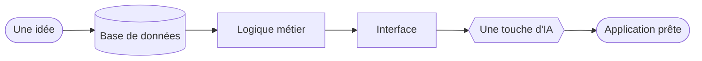

<div align="center">


<br>

<a href="#terminal-interactif"></a>
<a href="#projet-phare"></a>
<a href="#mes-outils"></a>
<a href="#mon-parcours"></a>
<a href="#contact"></a>

<br><br>

*Je transforme des idées en applications complètes : de la base de données à l'interface, avec une touche d'intelligence artificielle.*


</div>

---

## Choisis ton chemin

<table>
<tr>
<td width="33%" valign="top">

**Tu recrutes ?**

Mon projet phare, mon parcours et mes stages.

[Voir le projet phare](#projet-phare)
[Voir mon parcours](#mon-parcours)

</td>
<td width="33%" valign="top">

**Tu es développeur·se ?**

Mes projets, mon code et mes outils.

[Voir les autres projets](#autres-projets)
[Voir mes outils](#mes-outils)

</td>
<td width="33%" valign="top">

**Tu es curieux·se ?**

Interroge mon terminal, ou essaie mon portfolio interactif.

[Ouvrir le terminal](#terminal-interactif)
[Aller au portfolio](https://chaymae-el-bahloul.github.io)

</td>
</tr>
</table>

---

## Terminal interactif

*Clique sur une commande pour voir la réponse.*

<details>
<summary><code>$ about</code></summary>

```text
Chaymae El Bahloul, étudiante en Bachelor Science des Données (EST Kelâa des Sraghna)
après un DUT en Ingénierie des Données. Je transforme des idées en applications
complètes : base de données, interface et IA.
```

</details>

<details>
<summary><code>$ stack</code></summary>

```text
Python, R, SQL, JavaScript, PHP, C
Flask, Streamlit, SQLAlchemy
MySQL, SQLite
Hadoop, Kafka, Apache Spark, Power BI
Docker, Git
```

</details>

<details>
<summary><code>$ projets</code></summary>

```text
RC Gestion             Streamlit, paie, rapports PDF, IA   (projet phare)
GraphGen               Flask, Plotly, Docker               (en binôme)
Smart Data Pipeline    pipeline de données                 (en binôme, PFE)
Dashboard supermarché  Python, Jupyter
Gestion de congés      Flask, bilingue FR/AR               (stage 2025)
AI ChatBot             API Gemini
stadium_db             C, GTK, MySQL
```

</details>

<details>
<summary><code>$ parcours</code></summary>

```text
2026-2027        Bachelor Science des Données (en cours)
avril-juin 2026  Stage : RC Gestion
2024-2026        DUT Ingénierie des Données
juin-juil. 2025  Stage : gestion de congés, Commune de Kelâa des Sraghna
2023-2024        Baccalauréat Sciences Physiques
```

</details>

<details>
<summary><code>$ langues</code></summary>

```text
arabe (langue maternelle) · français (professionnel) · anglais (professionnel)
```

</details>

<details>
<summary><code>$ contact</code></summary>

```text
c.elbahloul2898@uca.ac.ma
linkedin.com/in/chaymae-el-bahloul
github.com/Chaymae-El-Bahloul
```

</details>

<details>
<summary><code>$ sudo recruter chaymae</code></summary>

```text
[sudo] mot de passe : ********
Permission accordée.
Étape suivante : écrire à c.elbahloul2898@uca.ac.ma
```

</details>

---

## Qui suis-je ?

```python
chaymae = {
    "etudes":  "Bachelor Science des Données (EST Kelâa des Sraghna)",
    "base":    "DUT Ingénierie des Données, Université Cadi Ayyad",
    "stack":   ["Python", "SQL", "Flask", "Streamlit"],
    "passion": "IA & Data",
    "lieu":    "El Kelâa des Sraghna, Maroc",
    "langues": ["arabe", "français", "anglais"],
}
```

J'aime construire des applications complètes autour des données : interface, logique métier, base de données et intelligence artificielle. Chaque projet est l'occasion d'apprendre une nouvelle brique, de la paie au chatbot en passant par la visualisation.



---

## Projet phare

> ### RC Gestion
> **Une application web qui digitalise la gestion d'un cabinet comptable.**
> Dossiers clients (personnes physiques et morales), déclarations fiscales, comptabilité simplifiée, paie et suivi de création d'entreprises.
> Elle génère automatiquement bulletins de paie, fiches clients et rapports PDF, envoie des alertes et intègre un module d'IA. Trois rôles : **Admin**, **Comptable**, **Client**.
>
>    
>
> **[Voir le code](https://github.com/Chaymae-El-Bahloul/RC-GESTION)**

<details>
<summary><b>Découvrir comment RC Gestion est construit</b></summary>
<br>

| Fichier | Rôle |
| --- | --- |
| `app.py` | interface et navigation |
| `db.py` | logique métier et données |
| `pdf_reports.py` | bulletins et rapports |
| `ai.py` | modèles d'IA |

</details>

## Autres projets

*Clique sur un projet pour le déplier.*

<details>
<summary><b>GraphGen</b> · analyse de données en quelques clics <i>(en binôme)</i></summary>
<br>

Importe un fichier **CSV ou Excel** et obtiens une analyse exploratoire (profil des colonnes, valeurs manquantes, corrélations) et des graphiques interactifs, sans écrire une ligne de code.

**Qualité :** 12 tests automatiques, intégration continue GitHub Actions, conteneur Docker.

`Flask` `pandas` `Plotly` `Docker` `pytest`

[Voir le code](https://github.com/Chaymae-El-Bahloul/GraphGen)

</details>

<details>
<summary><b>Smart Data Pipeline</b> · projet de fin d'études <i>(en binôme)</i></summary>
<br>

Pipeline de données auto-adaptatif, réalisé pour le projet de fin d'études du DUT.

`Python` `Pipeline de données`

[Voir le code](https://github.com/Samah-boudallaa/smart-data-pipeline-pfe)

</details>

<details>
<summary><b>Dashboard supermarché</b> · visualiser les ventes</summary>
<br>

Tableau de bord d'analyse et de visualisation des données de ventes d'un supermarché, réalisé dans un notebook Jupyter.

`Python` `Jupyter`

[Voir le code](https://github.com/Chaymae-El-Bahloul/dashboard-supermarche)

</details>

<details>
<summary><b>Gestion de congés</b> · stage 2025, Commune de Kelâa des Sraghna</summary>
<br>

Suivi des employés, demandes et validation hiérarchique des congés, statistiques automatiques. Interface **bilingue français / arabe**.

`Flask` `SQLAlchemy` `SQLite`

</details>

<details>
<summary><b>AI ChatBot</b> · un assistant multilingue</summary>
<br>

Chatbot multilingue basé sur l'API Gemini, avec gestion des requêtes des utilisateurs.

`Python` `Gemini API`

</details>

<details>
<summary><b>stadium_db</b> · gérer des étudiants (CRUD)</summary>
<br>

Application de bureau de gestion d'étudiants (création, lecture, modification, suppression), connectée à une base MySQL.

`C` `GTK` `MySQL`

[Voir le code](https://github.com/Chaymae-El-Bahloul/stadium_db)

</details>

---

## Mes outils

<p align="center">
  
</p>

*Déplie un domaine pour voir le détail.*

<details><summary><b>Langages</b></summary>

Python, R, SQL, JavaScript, PHP, C

</details>

<details><summary><b>Web et applications</b></summary>

Flask, Streamlit, SQLAlchemy, HTML / CSS

</details>

<details><summary><b>Bases de données</b></summary>

MySQL, Oracle SQL Developer, SQLite, Data Warehouse

</details>

<details><summary><b>Big Data et analyse</b></summary>

Hadoop, Kafka, Apache Spark, Power BI, Data Mining, apprentissage automatique

</details>

<details><summary><b>Intelligence artificielle</b></summary>

IA générative, API Gemini, Microsoft 365 Copilot

</details>

<details><summary><b>Outils de travail</b></summary>

Git / GitHub, Docker, Ubuntu, WSL, VirtualBox, VS Code

</details>

---

## Mon parcours

| Quand | Quoi |
| --- | --- |
| **2026 – 2027** | Bachelor Science des Données, EST Kelâa des Sraghna *(en cours)* |
| **Avril – juin 2026** | **Stage** : développement de RC Gestion (architecture en couches, calcul de la paie, bulletins automatiques, contrôle d'accès par rôle) |
| **2024 – 2026** | DUT Ingénierie des Données, EST Kelâa des Sraghna, Université Cadi Ayyad |
| **Juin – juillet 2025** | **Stage** : application web de gestion des congés pour la Commune de Kelâa des Sraghna |
| **2023 – 2024** | Baccalauréat Sciences Physiques, Lycée Al Maghrib Al Arabi |

<details>
<summary><b>Langues et certifications</b></summary>
<br>

**Langues :** arabe (langue maternelle) · français (professionnel) · anglais (professionnel)

**Certifications :** Career Essentials in Generative AI · Learning Microsoft 365 Copilot

</details>

---

## Contact

<div align="center">

### Une question, une idée de projet ?

<a href="mailto:c.elbahloul2898@uca.ac.ma"></a>
<a href="https://www.linkedin.com/in/chaymae-el-bahloul"></a>
<a href="https://chaymae-el-bahloul.github.io"></a>

<sub>Mon portfolio a un vrai terminal et un menu rapide : essaie Ctrl / ⌘ + K.</sub>

</div>
