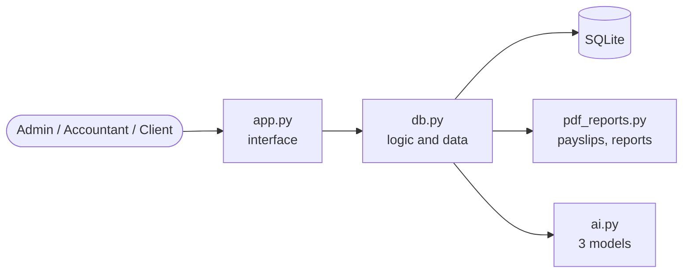
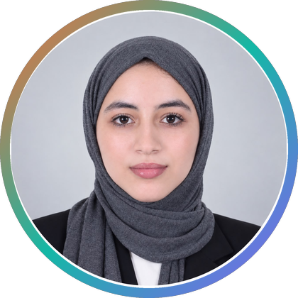

<div align="center">



<a href="#in-2-the-flagship"></a>
<a href="#in-3-the-method"></a>
<a href="#in-4-all-projects"></a>
<a href="#in-5-tools"></a>
<a href="#in-6-journey"></a>
<a href="#in-7-contact"></a>

<br><br>


</div>

&nbsp;

## In [2]: the flagship

> ### RC Gestion
> **What if the application could prevent tax delays instead of just recording them?**
>
> A web application that digitizes the management of an accounting firm: client files (individuals and companies), tax filings, simplified bookkeeping, payroll and company-creation tracking. It generates payslips, client sheets and PDF reports, sends alerts, and includes an AI module. Three roles: **Admin**, **Accountant**, **Client**.
>
>    
>
> **[Read the code](https://github.com/Chaymae-El-Bahloul/RC-GESTION)**

<p align="center"></p>
<p align="center"><sub>Animated preview drawn in SVG with demo data: the three models of <code>ai.py</code> at work.</sub></p>

<details>
<summary><b>Under the hood</b></summary>
<br>



| Model | Mission |
| --- | --- |
| Random Forest | Predict a client's risk of tax delay |
| Linear regression | Forecast next month's revenue |
| Isolation Forest | Detect suspicious declared amounts |

</details>

&nbsp;

## In [3]: the method

<p align="center"></p>

| I can... | Proof |
| --- | --- |
| **Design** a solid database and business logic | RC Gestion, Leave Management, stadium_db |
| **Build** a complete application, from the interface to deployment | RC Gestion, GraphGen (tests, CI, Docker) |
| **Analyze and visualize** data to support decisions | Supermarket Dashboard, GraphGen |
| **Add AI** where it brings real value | RC Gestion (3 ML models), AI ChatBot |

&nbsp;

## In [4]: all projects

```python
projects.sort_values("year", ascending=False)
```

| Project | What it does | Stack | Code |
| --- | --- | --- | --- |
| **GraphGen** *(pair project)* | Import a CSV or Excel file and get exploratory analysis and interactive charts, with no code. 12 tests, GitHub Actions CI, Docker. | `Flask` `pandas` `Plotly` `Docker` | [repo](https://github.com/Chaymae-El-Bahloul/GraphGen) |
| **Smart Data Pipeline** *(team of three)* | Self-adaptive data pipeline, built for the DUT final-year project. | `Python` | [repo](https://github.com/Samah-boudallaa/smart-data-pipeline) |
| **Supermarket Dashboard** | Interactive dashboard: 6 filters, 4 key indicators, 9 chart types (boxplot, heatmap, sunburst, gauge...), updated in real time. | `Streamlit` `Plotly` `Pandas` | [repo](https://github.com/Chaymae-El-Bahloul/dashboard-supermarche) |
| **Leave Management** *(2025 internship)* | Employee tracking, requests and hierarchical approval for the Municipality of Kelâa des Sraghna. Bilingual French / Arabic. | `Flask` `SQLAlchemy` `SQLite` | [repo](https://github.com/Chaymae-El-Bahloul/Gestion-Conges) |
| **AI ChatBot** | Multilingual chatbot based on the Gemini API, with user request handling. | `Python` `Gemini API` | [repo](https://github.com/Chaymae-El-Bahloul/AI-chatbot) |
| **stadium_db** *(team of 5)* | Desktop application for student management (add, edit, delete, search, display). | `C` `GTK+ 3` `MySQL` | [repo](https://github.com/Chaymae-El-Bahloul/stadium_db) |

<p align="center"><a href="https://github.com/Chaymae-El-Bahloul?tab=repositories">All my repositories</a></p>

&nbsp;

## In [5]: tools

<p align="center"></p>

<details><summary><b>Full arsenal</b></summary>
<br>

| Domain | Tools |
| --- | --- |
| Languages | Python, R, SQL, JavaScript, PHP, C |
| Web and applications | Flask, Streamlit, SQLAlchemy, HTML / CSS |
| Databases | MySQL, Oracle SQL Developer, SQLite, Data Warehouse |
| Big Data and analytics | Hadoop, Kafka, Apache Spark, Power BI, Data Mining, machine learning |
| Artificial intelligence | Generative AI, Gemini API, Microsoft 365 Copilot, scikit-learn |
| Work tools | Git / GitHub, Docker, Ubuntu, WSL, VirtualBox, VS Code |

</details>

&nbsp;

## In [6]: journey

<p align="center"></p>



I love building complete applications around data: interface, business logic, database and artificial intelligence. Each project is a chance to learn a new building block, from payroll to chatbots to visualization.

**Right now**

| | |
| --- | --- |
| Studying | Bachelor in Data Science, EST Kelâa des Sraghna |
| Building | A live demo and deeper ML features for RC Gestion |
| Learning | Apache Spark and Kafka |
| Looking for | An internship in Data / AI / Software |

<br clear="all">

### Certifications

| Certification | Issuer | What it covers |
| --- | --- | --- |
| **Career Essentials in Generative AI** | Microsoft and LinkedIn Learning | Generative AI fundamentals, effective prompts, responsible use of AI tools at work |
| **Learning Microsoft 365 Copilot** | LinkedIn Learning | Copilot in Word, Excel, PowerPoint, Outlook and Teams |
| **Master Series 4.0: Smart Factories, Hypermanufacturing & Beyond** | UNIDO and the Digital Development Agency (ADD), Morocco | Webinar series "Industry 4.0 and Digital Transformation", June to September 2025 · [certificate](certificates/attestation-unido-add.pdf) |

&nbsp;

## In [7]: contact

<p align="center"></p>

<div align="center">

<a href="mailto:c.elbahloul2898@uca.ac.ma"></a>
<a href="https://www.linkedin.com/in/chaymae-el-bahloul"></a>
<a href="https://chaymae-el-bahloul.github.io"></a>

<sub>My portfolio has a real terminal and a quick menu: try Ctrl / ⌘ + K.</sub>

<br><br>

<picture>
  <source media="(prefers-color-scheme: dark)" srcset="https://raw.githubusercontent.com/Chaymae-El-Bahloul/Chaymae-El-Bahloul/output/github-contribution-grid-snake-dark.svg">
  
</picture>

</div>
