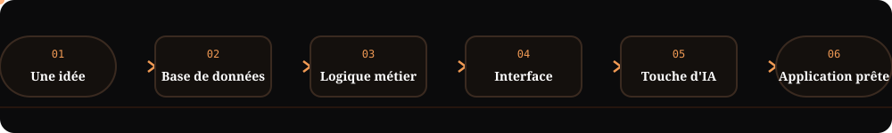
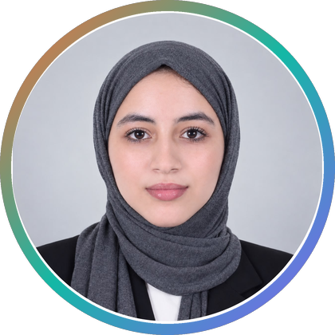
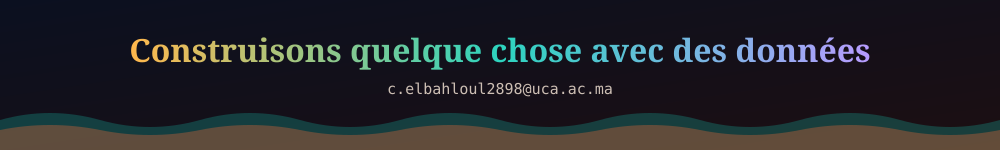

<div align="center">




<a href="#boot"></a>
<a href="#projet-phare"></a>
<a href="#mes-outils"></a>
<a href="#git-log"></a>
<a href="#contact"></a>

<br><br>

**Je transforme des idées en applications complètes : de la base de données à l'interface, avec une touche d'intelligence artificielle.**


</div>

<p align="center"></p>

## Boot

```text
$ ./chaymae --boot

[  OK  ] Profil chargé .............. Chaymae El Bahloul
[  OK  ] Formation .................. Bachelor Sciences des Données (en cours)
[  OK  ] Base solide ................ DUT Ingénierie des Données
[  OK  ] Stack ...................... Python · SQL · Flask · Streamlit · C
[  OK  ] Projets compilés ........... 7
[  OK  ] Stages validés ............. 2
[  OK  ] Langues .................... arabe · français · anglais
[ INFO ] Curiosité .................. illimitée
[ WAIT ] En attente de ton message .. c.elbahloul2898@uca.ac.ma
```

<p align="center"></p>

## Choisis ta mission

<table>
<tr>
<td width="33%" valign="top">

**Mission : recruter**

Mon projet phare, mon parcours et mes deux stages.

[Voir le projet phare](#projet-phare)<br>
[Voir mon git log](#git-log)

</td>
<td width="33%" valign="top">

**Mission : lire du code**

Mes projets, mes technologies, mes dépôts.

[Voir les projets](#tous-mes-projets)<br>
[Voir mes outils](#mes-outils)

</td>
<td width="33%" valign="top">

**Mission : explorer**

Interroge mon terminal, ou essaie mon portfolio interactif.

[Ouvrir le terminal](#terminal-interactif)<br>
[Aller au portfolio](https://chaymae-el-bahloul.github.io)

</td>
</tr>
</table>

<p align="center"></p>

## Ce que je sais faire

| Je peux... | Preuve |
| --- | --- |
| **Concevoir** une base de données et une logique métier solides | RC Gestion, Gestion de congés, stadium_db |
| **Construire** une application complète, de l'interface au déploiement | RC Gestion, GraphGen (tests, CI, Docker) |
| **Analyser et visualiser** des données pour décider | Dashboard supermarché, GraphGen |
| **Ajouter de l'IA** là où elle apporte une vraie valeur | RC Gestion (3 modèles ML), AI ChatBot |

<p align="center"></p>

<p align="center"></p>

## Projet phare

> ### RC Gestion
> **Et si l'application pouvait prévenir les retards fiscaux au lieu de les constater ?**
> Une application web qui digitalise la gestion d'un cabinet comptable : dossiers clients (personnes physiques et morales), déclarations fiscales, comptabilité simplifiée, paie et suivi de création d'entreprises.
> Elle génère automatiquement bulletins de paie, fiches clients et rapports PDF, envoie des alertes et intègre un module d'IA. Trois rôles : **Admin**, **Comptable**, **Client**.
>
>     
>
> **[Voir le code](https://github.com/Chaymae-El-Bahloul/RC-GESTION)**

<details>
<summary><b>Sous le capot de RC Gestion</b></summary>
<br>

```text
RC_Gestion_/
├── app.py            interface et navigation
├── db.py             logique métier et données
├── pdf_reports.py    bulletins et rapports
└── ai.py             modèles d'IA
```

| Modèle | Mission |
| --- | --- |
| Random Forest | Prédire le risque de retard fiscal d'un client |
| Régression linéaire | Prévoir le chiffre d'affaires du mois suivant |
| Isolation Forest | Détecter les montants déclarés suspects |

</details>

## Tous mes projets

<table>
<tr>
<td width="33%" valign="top">

**GraphGen** *(en binôme)*

Importe un CSV ou Excel et obtiens l'analyse exploratoire et des graphiques interactifs, sans écrire une ligne de code. 12 tests, CI GitHub Actions, Docker.

`Flask` `pandas` `Plotly` `Docker`

[Voir le code](https://github.com/Chaymae-El-Bahloul/GraphGen)

</td>
<td width="33%" valign="top">

**Smart Data Pipeline** *(en trinôme, PFE)*

Pipeline de données auto-adaptatif, réalisé pour le projet de fin d'études du DUT.

`Python` `Pipeline de données`

[Voir le code](https://github.com/Samah-boudallaa/smart-data-pipeline-pfe)

</td>
<td width="33%" valign="top">

**Dashboard supermarché**

Tableau de bord interactif : 6 filtres, 4 indicateurs clés et 9 types de visualisations (boxplot, heatmap, sunburst, gauge...), mis à jour en temps réel.

`Streamlit` `Plotly` `Pandas`

[Voir le code](https://github.com/Chaymae-El-Bahloul/dashboard-supermarche)

</td>
</tr>
<tr>
<td width="33%" valign="top">

**Gestion de congés** *(stage 2025)*

Suivi des employés, demandes et validation hiérarchique pour la Commune de Kelâa des Sraghna. Interface bilingue français / arabe.

`Flask` `SQLAlchemy` `SQLite`

</td>
<td width="33%" valign="top">

**AI ChatBot**

Chatbot multilingue basé sur l'API Gemini, avec gestion des requêtes des utilisateurs.

`Python` `Gemini API`

</td>
<td width="33%" valign="top">

**stadium_db** *(en équipe de 5)*

Application de bureau de gestion d'étudiants (ajout, modification, suppression, recherche, affichage).

`C` `GTK+ 3` `MySQL`

[Voir le code](https://github.com/Chaymae-El-Bahloul/stadium_db)

</td>
</tr>
</table>

<p align="center"><a href="https://github.com/Chaymae-El-Bahloul?tab=repositories">Voir tous mes dépôts</a></p>

<p align="center"></p>

## Mes outils

<p align="center"></p>

<p align="center"></p>

*Déplie un domaine pour voir tout l'arsenal.*

<details><summary><b>Langages</b></summary>

Python, R, SQL, JavaScript, PHP, C

</details>

<details><summary><b>Web et applications</b></summary>

Flask, Streamlit, SQLAlchemy, HTML / CSS

</details>

<details><summary><b>Bases de données</b></summary>

MySQL, Oracle SQL Developer, SQLite, Data Warehouse

</details>

<details><summary><b>Big Data et analyse</b></summary>

Hadoop, Kafka, Apache Spark, Power BI, Data Mining, apprentissage automatique

</details>

<details><summary><b>Intelligence artificielle</b></summary>

IA générative, API Gemini, Microsoft 365 Copilot, scikit-learn

</details>

<details><summary><b>Outils de travail</b></summary>

Git / GitHub, Docker, Ubuntu, WSL, VirtualBox, VS Code

</details>

<p align="center"></p>

## En chiffres

<table>
<tr>
<td width="50%" align="center"></td>
<td width="50%" align="center"></td>
</tr>
</table>

<p align="center"></p>

## Terminal interactif

*Clique sur une commande pour voir la réponse.*

<details>
<summary><code>$ about</code></summary>

```text
Chaymae El Bahloul, étudiante en Bachelor Sciences des Données (EST Kelâa des Sraghna)
après un DUT en Ingénierie des Données. Je transforme des idées en applications
complètes : base de données, interface et IA.
```

</details>

<details>
<summary><code>$ ls projets/</code></summary>

```text
RC_Gestion/    GraphGen/    smart-data-pipeline/    dashboard-supermarche/
gestion-conges/    ai-chatbot/    stadium_db/
```

</details>

<details>
<summary><code>$ langues</code></summary>

```text
arabe (langue maternelle) · français (professionnel) · anglais (professionnel)
```

</details>

<details>
<summary><code>$ fortune</code></summary>

```text
Un bug, c'est juste une fonctionnalité
qui n'a pas encore trouvé son utilisateur.
```

</details>

<details>
<summary><code>$ sudo recruter chaymae</code></summary>

```text
[sudo] mot de passe : ********
Permission accordée.
Étape suivante : écrire à c.elbahloul2898@uca.ac.ma
```

</details>

<p align="center"></p>

## Qui suis-je ?



J'aime construire des applications complètes autour des données : interface, logique métier, base de données et intelligence artificielle. Chaque projet est l'occasion d'apprendre une nouvelle brique, de la paie au chatbot en passant par la visualisation.

```python
chaymae = {
    "etudes":  "Bachelor Sciences des Données (EST Kelâa des Sraghna)",
    "base":    "DUT Ingénierie des Données, Université Cadi Ayyad",
    "stack":   ["Python", "SQL", "Flask", "Streamlit"],
    "passion": "IA & Data",
    "lieu":    "El Kelâa des Sraghna, Maroc",
    "langues": ["arabe", "français", "anglais"],
}
```

<br clear="all">

<p align="center"></p>

## Git log

<p align="center"></p>

*Mon parcours, raconté comme un historique de commits.*

```text
$ git log --oneline

a7f3c21 (HEAD -> main) 2026-2027      Bachelor Sciences des Données, EST Kelâa des Sraghna (en cours)
5be90d4                avr-juin 2026  Stage : RC Gestion (architecture en couches, paie, bulletins, rôles)
3c1d8e7                juin-juil 2025 Stage : gestion de congés, Commune de Kelâa des Sraghna
9a02f6b                2024-2026      DUT Ingénierie des Données, EST Kelâa des Sraghna, UCA
1e4d7a0                2023-2024      Baccalauréat Sciences Physiques, Lycée Al Maghrib Al Arabi
0000000 (initial)      depuis toujours  la curiosité
```

<details>
<summary><b>Langues et certifications</b></summary>
<br>

**Langues :** arabe (langue maternelle) · français (professionnel) · anglais (professionnel)

**Certifications :** Career Essentials in Generative AI · Learning Microsoft 365 Copilot

</details>

<p align="center"></p>

## Mon activité

<p align="center">
<picture>
  <source media="(prefers-color-scheme: dark)" srcset="https://raw.githubusercontent.com/Chaymae-El-Bahloul/Chaymae-El-Bahloul/output/github-contribution-grid-snake-dark.svg">
  
</picture>
</p>

<p align="center"></p>

## Contact

<div align="center">

### Une question, une opportunité, une idée de projet ?

<a href="mailto:c.elbahloul2898@uca.ac.ma"></a>
<a href="https://www.linkedin.com/in/chaymae-el-bahloul"></a>
<a href="https://chaymae-el-bahloul.github.io"></a>

<sub>Mon portfolio a un vrai terminal et un menu rapide : essaie Ctrl / ⌘ + K.</sub>

</div>

<p align="center"></p>
